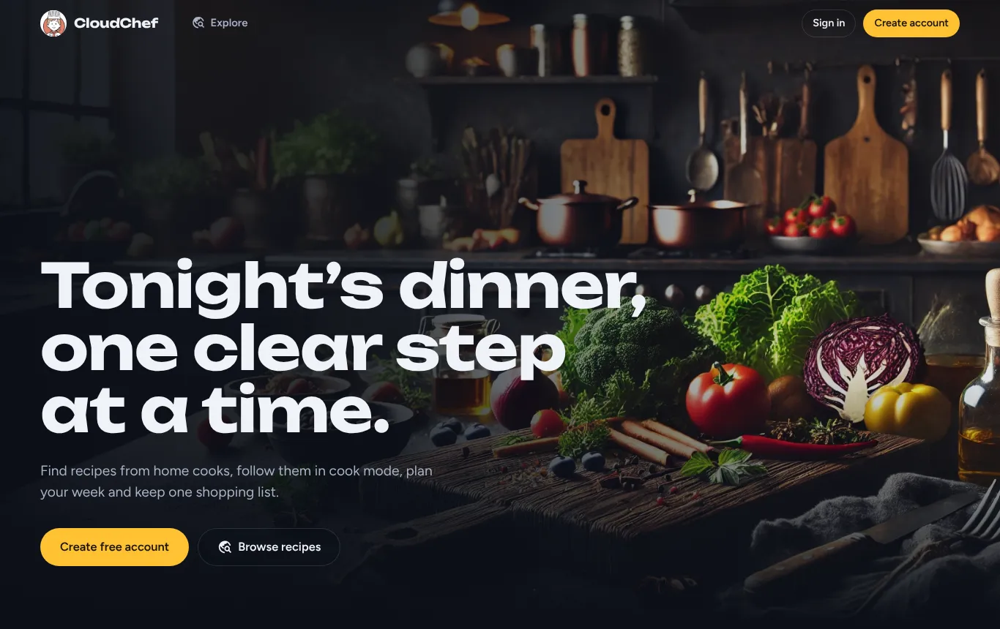
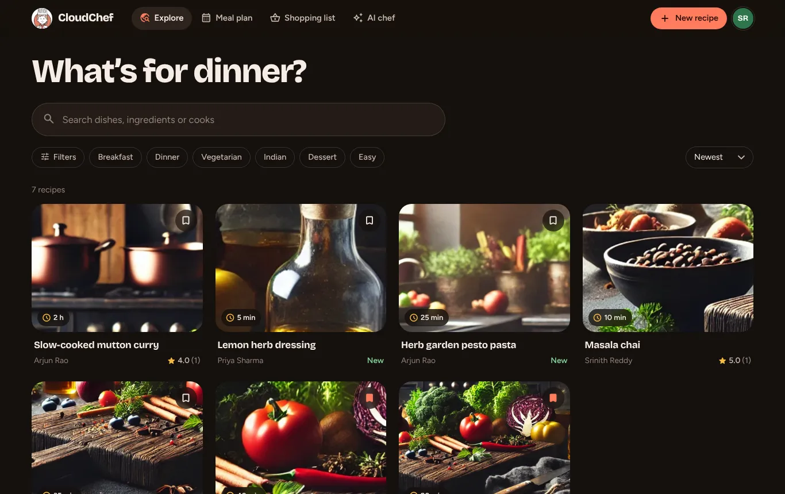
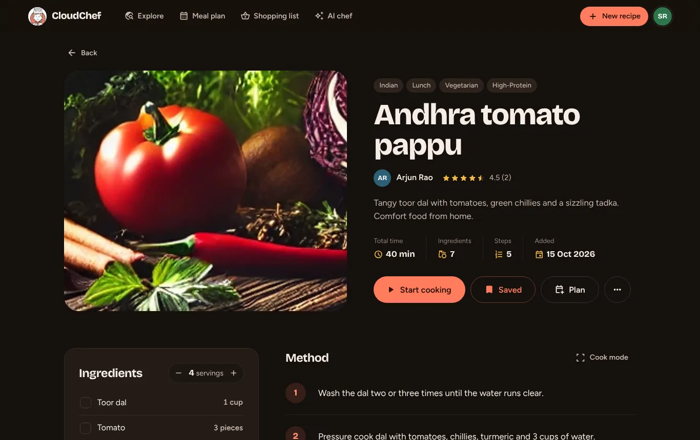
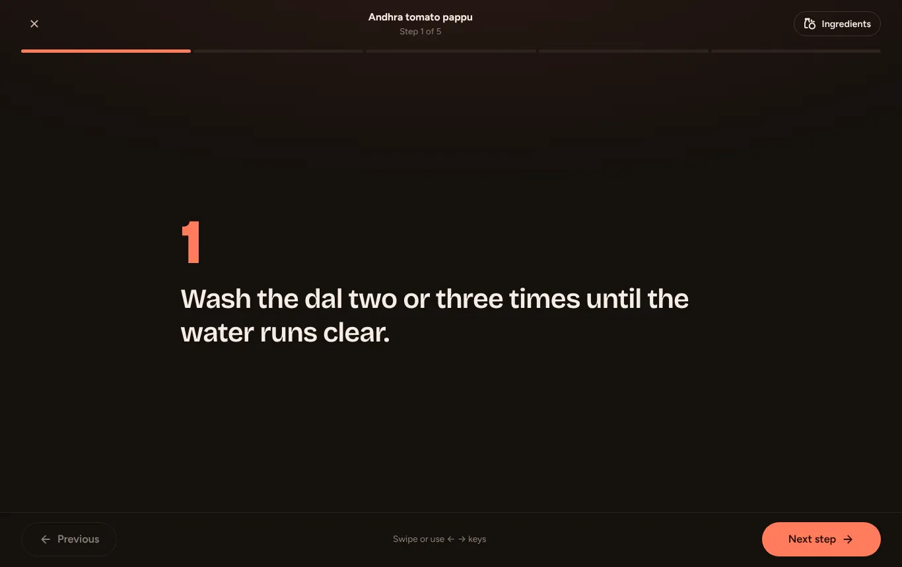
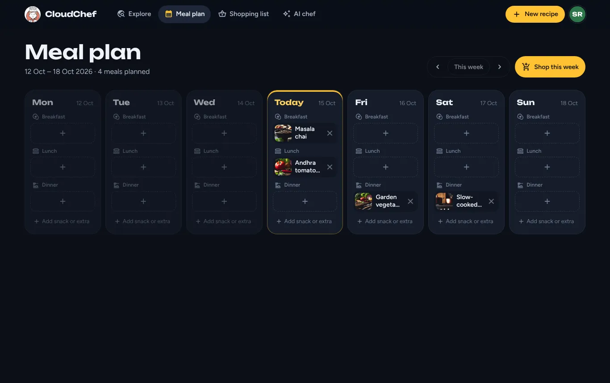
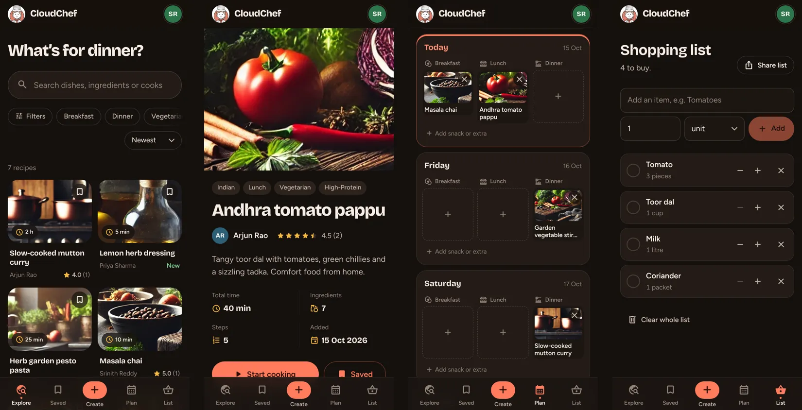

# CloudChef

A recipe app for home cooks. Share recipes, follow them in a full-screen cook mode with timers, plan your week, keep one shopping list, and ask an AI chef what to make from the food you already have.

Built with **React 18**, **Express**, **MongoDB** and **Google Gemini**.



| Explore | Recipe |
| --- | --- |
|  |  |
| **Cook mode** | **Meal plan** |
|  |  |



## Features

- **Explore** — search by dish, ingredient or cook; filter by cuisine, meal, diet, difficulty and cooking time; sort by newest, top rated or quickest. Filters live in the URL, so a filtered list can be shared.
- **Recipe page** — scale servings (quantities update, including fractions), tick off ingredients you have, send the rest to your shopping list, nutrition per serving, step photos and videos.
- **Cook mode** — one big step at a time, swipe or arrow keys, per-step countdown timers with a chime and vibration, timers keep running while you move between steps, screen stays awake.
- **Recipe editor** — five-step wizard for creating and editing, with validation, drag-and-drop cover photo, step photos/videos, reordering, live nutrition estimate, and an auto-saved draft.
- **AI chef (Gemini)** — type ingredients or snap a photo of your fridge; get a complete recipe and open it in the editor to publish.
- **Meal plan** — week view with breakfast, lunch, dinner and snacks; add meals straight from the planner; “Shop this week” sends every ingredient to the list.
- **Shopping list** — same items merge, tick items into the basket, quantity steppers, share the list, one-tap Instamart search.
- **Social** — public cook profiles, follow cooks, signature dish, star ratings and written reviews.
- **Accounts** — email sign-up with a 6-digit code, Google sign-in, password reset, password change with email confirmation.
- **Admin** — stats, manage cooks and roles, remove recipes, review reports from users.
- **Dark, warm UI** — designed for phones first, smooth page and modal animations, respects “reduce motion”, keyboard friendly.

## Run it locally

You need **Node.js 18+** and a **MongoDB** database (a free [MongoDB Atlas](https://www.mongodb.com/atlas) cluster works).

```bash
# 1. Install everything
npm run install-all

# 2. Create the backend settings file
cp backend/.env.example backend/.env      # Windows: copy backend\.env.example backend\.env
#    then open backend/.env and set at least MONGO_URI and SECRET

# 3. Start the API (http://localhost:4000)
npm run dev:api

# 4. In a second terminal, start the website (http://localhost:3000)
npm run dev:web
```

Make yourself an admin:

```bash
cd backend
npm run create-admin -- you@example.com "a-strong-password" Your Name
```

### Optional services

Everything works without these. Each one switches on a feature.

| Setting in `backend/.env` | What it enables | Where to get it |
| --- | --- | --- |
| `GEMINI_API_KEY` | AI chef | [Google AI Studio](https://aistudio.google.com/apikey) |
| `CLOUDINARY_CLOUD_NAME`, `CLOUDINARY_API_KEY`, `CLOUDINARY_API_SECRET` | Photo and video hosting (otherwise files go to `backend/uploads`) | [Cloudinary](https://cloudinary.com) dashboard |
| `EMAIL_USER`, `EMAIL_PASSWORD` | Real verification emails (otherwise the code is printed in the API console) | Gmail + a Google **App password** |
| `GOOGLE_CLIENT_ID` | “Sign in with Google” button | Google Cloud Console → Credentials → OAuth client ID (web) |

## Deploy as one server

```bash
npm run build   # builds the React app into frontend/build
npm start       # the API now also serves the website on PORT
```

Set `CLIENT_URL` to your site’s address if the frontend is hosted somewhere else, and `REACT_APP_API_URL` when building the frontend in that case.

## Tests

```bash
npm test
```

Backend unit tests cover auth, quantity parsing, nutrition estimates, AI response cleanup and calendar dates.

## Project structure

```
backend/
  controllers/   request handlers (auth, recipes, ratings, cart, calendar, admin, ai…)
  models/        Mongoose schemas
  routes/        URL → controller wiring, with auth middleware
  services/      nutrition estimates, Gemini recipe generation
  config/        uploads (Cloudinary or local disk)
  scripts/       create-admin and data migrations
  tests/         Jest tests
frontend/src/
  api/           one fetch wrapper for every API call
  context/       signed-in user, saved recipes, toasts and confirm dialogs
  components/    navbar, recipe card, modal, reviews, dialogs…
  pages/         one file per screen
  styles/        design tokens, shared components, page styles
```

## Upgrading from the old version

Old URLs such as `/welcome`, `/cart` or `/user/:id` redirect to their new pages. If your database has ratings from the old version, run once:

```bash
cd backend && npm run migrate-ratings
```

## License

GPL-3.0, see [LICENSE](LICENSE).
